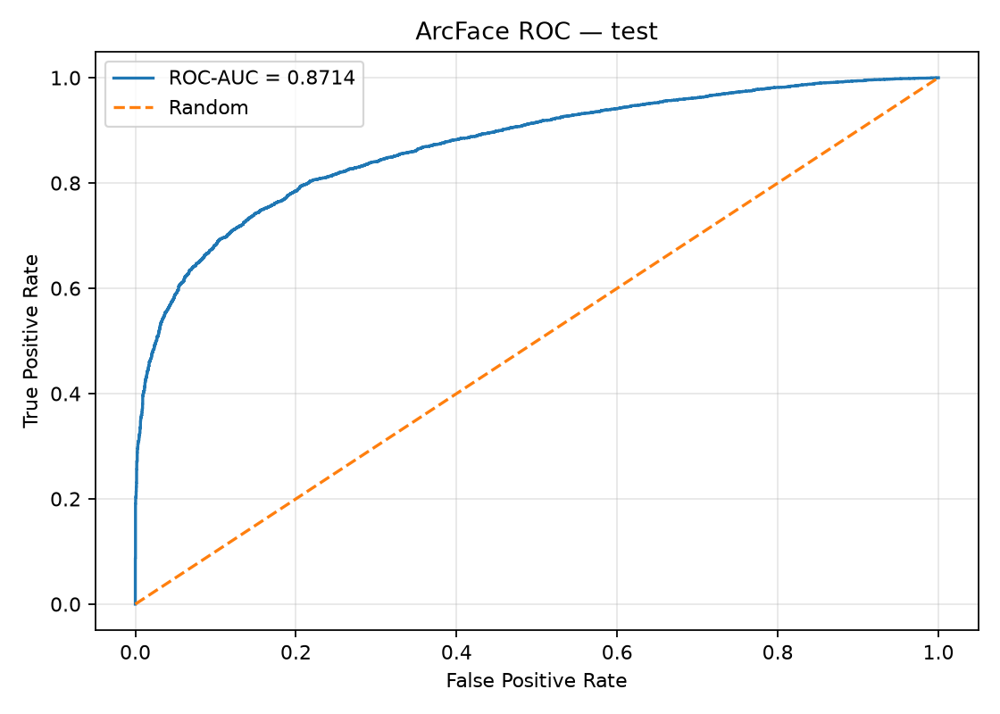
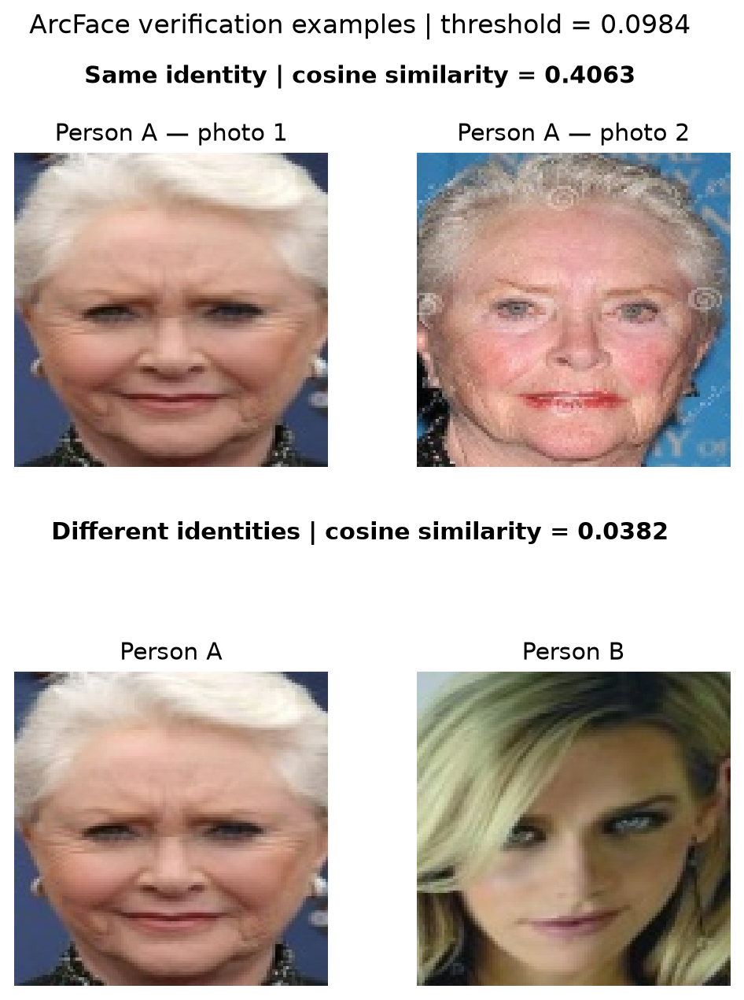

# Face Recognition — Stacked Hourglass + ArcFace

Проект по распознаванию лиц на Python с использованием PyTorch, OpenCV и датасета CelebA.

Цель проекта — разработать систему, которая находит лица на фотографии, выравнивает их и получает эмбеддинги для сравнения людей.

## Как работает система

```text
Фотография
    ↓
Face Detection (OpenCV)
    ↓
Stacked Hourglass — 5 ключевых точек лица
    ↓
Face Alignment — 112×112
    ↓
ResNet18 + ArcFace
    ↓
Эмбеддинг (1024)
    ↓
Cosine Similarity
```

Для определения ключевых точек использовалась самостоятельно обученная **Stacked Hourglass**. Для распознавания были обучены две модели: **ResNet18 + Cross Entropy** и **ResNet18 + ArcFace**.

## Датасет

Для обучения использовался **CelebA**.

- 500 выбранных личностей.
- 9 979 изображений после подготовки.
- 400 личностей для обучения моделей распознавания.
- 100 отложенных личностей для проверки эмбеддингов.

## Результаты

### Классификация лиц

| Модель | Validation Accuracy | Test Accuracy |
|---|---:|---:|
| ResNet18 + Cross Entropy | 71.36% | 68.59% |
| ResNet18 + ArcFace | **79.61%** | **77.49%** |

ArcFace показала результат на **8.90 процентного пункта выше** на тестовой выборке.

### Сравнение лиц

Дополнительно модель проверялась на личностях, которые не участвовали в обучении ArcFace.

| Метрика | Test |
|---|---:|
| ROC-AUC | **0.8714** |
| Pair Accuracy | **79.60%** |
| Cosine similarity threshold | 0.0984 |

Порог был подобран на validation и использован на test без изменений.



### Примеры сравнения

На двух фотографиях одного человека сходство составило **0.4063**, а на фотографиях разных людей — **0.0382**.



## Запуск проекта

Установить зависимости:

```bash
python -m pip install -r requirements.txt
```

Поместить обученные веса `best_hourglass.pth` и `best_resnet18_arcface.pth` в папку `checkpoints/`.

Запустить обработку фотографии из корня проекта:

```bash
python src/demo.py --image data/test_faces.jpg
```

Программа сохраняет в `data/pipeline_results/` фотографию с найденными лицами и ключевыми точками, выровненные изображения лиц и их эмбеддинги.

Для повторной оценки ArcFace:

```bash
python src/evaluate_embeddings.py
```

Для этого необходимы архив `data/aligned_faces_112.zip` и CSV-файлы в `data/processed/splits/`.

## Вывод

В проекте удалось реализовать полный пайплайн обработки лиц с использованием собственной Stacked Hourglass и обученной ArcFace.

По результатам экспериментов ArcFace показала более высокую точность классификации, чем ResNet18 с Cross Entropy. Проверка на неизвестных личностях также показала, что полученные эмбеддинги позволяют различать изображения одного человека и разных людей.

Основная система работает, однако качество обнаружения и сравнения лиц может снижаться на фотографиях со сложными ракурсами и освещением. Подробности обучения и экспериментов находятся в папке `notebooks/`.